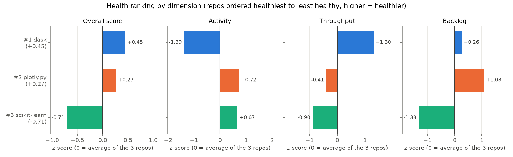
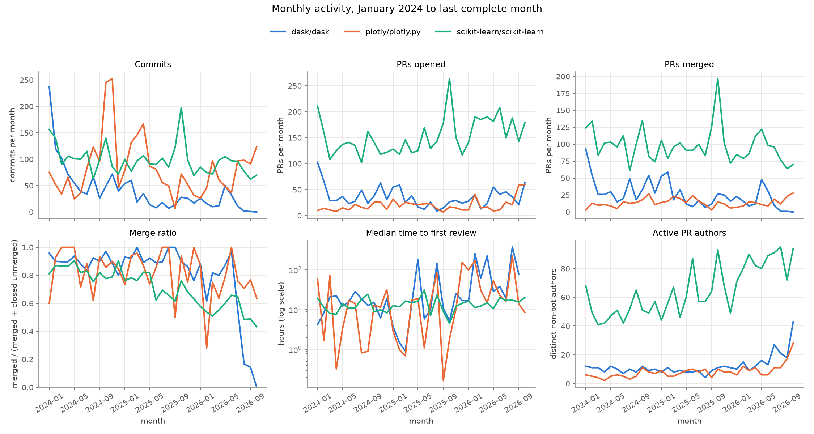
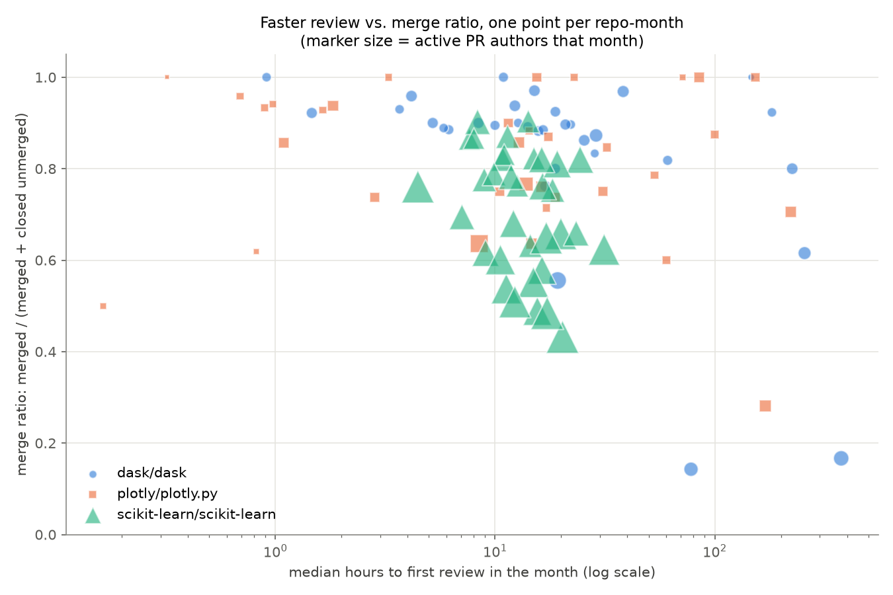

## Overview

This pipeline extracts and loads data from Set B, which is the scikit-learn/scikit-learn, dask/dask, and plotly/plotly.py package set. It extracts the repos with the endpoints "commits," "pulls," "reviews," and "releases" and loads them into tables using duckdb. Then, dbt is used to build 4 stg of the commits, PR reviews, pull requests, and releases, 2 fct of the pull requests and releases, and 2 marts of the health inputs and the monthly events.  

## Setup and Run 

- Create a virtual environment (.venv)
- pip install -r requirements.txt
- export GH_PAT=...
- Run python main.py

Expect runtime: about 2+ hours for a full run, a few minutes for an incremental run. 

## Task 1: Extract

**Excerpt from logs/run_interrupted.log:**

18:01:17.289 | INFO    | Task run 'fetch_single_page-ea9' - Rate Limit remaining: 2416
18:01:17.291 | INFO    | Task run 'fetch_single_page-ea9' - Finished in state Completed()
18:01:17.713 | INFO    | Task run 'fetch_single_page-d39' - Rate Limit remaining: 2415
18:01:17.716 | INFO    | Task run 'fetch_single_page-d39' - Finished in state Completed()
18:01:18.142 | INFO    | Task run 'fetch_single_page-883' - Rate Limit remaining: 2414
18:01:18.146 | INFO    | Task run 'fetch_single_page-883' - Finished in state Completed()

**Excerpt from logs/run_resumed.log:**

18:05:23.292 | INFO    | prefect - Starting temporary server on http://127.0.0.1:8798
See https://docs.prefect.io/v3/concepts/server#how-to-guides for more information on running a dedicated Prefect server.
18:05:24.947 | INFO    | Flow run 'caped-seriema' - Beginning flow run 'caped-seriema' for flow 'package-health'
18:05:24.963 | INFO    | Task run 'extract-2b8' - No _LOADED: resuming, pages on disk will be skipped
18:05:26.421 | INFO    | Task run 'fetch_single_page-faf' - Rate Limit remaining: 2412
18:05:26.426 | INFO    | Task run 'fetch_single_page-faf' - Finished in state Completed()
18:05:27.005 | INFO    | Task run 'fetch_single_page-004' - Rate Limit remaining: 2411
18:05:27.008 | INFO    | Task run 'fetch_single_page-004' - Finished in state Completed()
18:05:27.456 | INFO    | Task run 'fetch_single_page-19c' - Rate Limit remaining: 2410
18:05:27.461 | INFO    | Task run 'fetch_single_page-19c' - Finished in state Completed()

## Task 2: Load

**Incremental Loads**

| Run | API Requests |
|---|---|
| Full (run_full.log) | 7,294 |
|---|---|
| Incremental (run_incremental.log) | 37|

**Idempotency**

The first run produced  7,531 / 8,500 / 21,806 / 204 rows, and logs/load_run2.log has the same numbers:

shows the same numbers:
raw_commits: 7531 rows
raw_pull_requests: 8500 rows
raw_pr_reviews: 21806 rows
raw_releases: 204 rows

This is because loads use INSERT OR REPLACE on the (repo, id) primary key, so loading the same record again replaces the existing row instead of adding a new one. 

**Table Design**

There is one table per endpoint, one row per record, typed key columns plus the full record as payload JSON. 

## Task 3: dbt

dbt build runs inside the flow and builds 8 models in packages.duckdb, then runs 30 tests. The flow fails if any model or test fails. dbt's own log is written to logs/dbt.log.

**Models**

| Layer | Models | Materialized as |
|---|---|---|
| Staging | `stg_commits`, `stg_pull_requests`, `stg_pr_reviews`, `stg_releases` | views |
| Facts | `fct_pull_requests`, `fct_releases` | tables |
| Marts | `mart_repo_monthly`, `mart_health_inputs` | tables |

**Staging** pulls the needed fields out of the raw payload JSON, casts timestamps to 'TIMESTAMPTZ' (UTC), and keeps only the newest row per (repo, id) using 'qualify row_number() over (partition by repo, id order by fetched_at desc) = 1'. stg_pr_reviews drops PENDING reviews, and 'stg_releases' drops drafts.

**fct_pull_requests** has one row per PR created since 2024-01-01, with flags ('is_merged', 'is_open', 'is_stale', ...) and durations ('hours_to_first_review', 'hours_to_merge', 'hours_to_close'). The first review excludes reviews by the PR author and by bots. 

**fct_releases** computes 'days_since_previous' with lag() before filtering to 2024, so the first 2024 release still measures its gap to the release before it.

**mart_repo_monthly** builds a repo x month spine from January 2024 to the run month with 'generate_series', so months with no activity show 0 instead of disappearing.

**mart_health_inputs** has one row per repo with every metric scored in Task 5.

All dbt timestamps us UTC so events are counted in the correct month no matter where the pipeline runs.

**Bot rule**

is_bot = user.type = 'Bot' OR user.login LIKE '%[bot], applied to PR authors, viewers, and commit authors. When the user is missing, 'is_bot' is 'false.' The rule flagged 79 bot commits, 145 bot PRs and 116 bot reviews.

**Tests**

**Generic**: `unique` and `not_null` on every primary key, `relationships` from `stg_pr_reviews.pr_number` to `stg_pull_requests.number`, and `accepted_values` on PR state (`open`, `closed`) and review state (`APPROVED`, `CHANGES_REQUESTED`, `COMMENTED`, `DISMISSED`). Primary keys are `(repo, id)` pairs, so uniqueness is tested on the combined expression, e.g. `repo || '/' || number`. 

**Singular**: `assert_pr_closed_after_created` returns any PR closed or merged before it was created, and `assert_review_after_pr_created` returns any review submitted before its PR was created. Each passes when it returns no rows. 

Result: PASS=38 WARN=0 ERROR=0 (8 models + 30 tests)

## Task 4: Validation

The validate task is written in Python.

**Completeness checks**

1. **Files -> raw tables**: ever `(repo, id)` in data/raw/ must exist in its raw table. After an incremental run, data/raw/ holds only the new pages, so the check is that the files are a subset of the table.
2. **Raw -> staging**: each staging model's row count must equal its raw table's, after applying the same filter staging uses (no PENDING reviews, no draft releases). All four matched: 7,546 commits, 8,805 PRs, 21,859 reviews, 204 releases.
3. **Commits every complete month**: every repo must have commits in every complete month (the current month is exempt). 

Check 3 found one gap: dask/dask has 0 commits in October 2026. Dask's activity fell through 2026 (2 commits in August, 1 in September) and its merged PRs fell the same way. The month is listed in `KNOWN_GAPS` in main.py and logged as a warning; any other gap fails the task.

**Outlier detection**

An outlier occurs if it's above Q3 + 3 * (Q3-Q1), computed separately for each repo. Since the durations are heavily right-skewed, I used 3 instead of the typical 1.5. 

| Repo | Time-to-merge cutoff | PRs flagged | Longest merge | Weeks with unusually many commits |
|---|---|---|---|---|
| dask/dask | 11.9 days | 73 | 215 days | 2024-01-08 (77), 2024-01-15 (75) |
| plotly/plotly.py | 39.8 days | 56 | 492 days | 2024-10-21 (98) |
| scikit-learn/scikit-learn | 32.0 days | 365 | 777 days | 2025-10-06 (83) |

The 5 slowest merges per repo are listed in the `validate` log.

Decision to keep all flagged records: They are real events, not errors. Dropping them would. hide real slowness, which is part of what a health score should capture.

**Descriptive statistics** (read from `fct_pull_requests` and `mart_health_inputs`)

| Repo | First review, median / p90 (h) | Merge, median / p90 (h) | Commits per week | Releases per year |
|---|---|---|---|---|
| dask/dask | 12.3 / 211.5 | 12.3 / 216.8 | 9.3 | 15.5 |
| plotly/plotly.py | 16.1 / 693.2 | 40.6 / 1,130.2 | 19.0 | 10.2 |
| scikit-learn/scikit-learn | 13.0 / 274.5 | 36.6 / 838.7 | 22.7 | 5.3 |

p90 is the 90th percentile: 90% of PRs were reviewed or merged within that time. The gap between median and p90 shows how long the slowest 10% wait. Plotly's is the widest: a typical PR merges in under 2 days, but the slowest 10% take more than 47 days.

## Task 5: Model

The three dimensions I chose were activity (weight=0.2 because throughput and backlog reveal more about specific activities than commits), throughput (weight=0.5 because merging contributions, and doing it quickly, is the clearest sign a project is actively maintained. A project can have many commits and still ignore outside contributions), and backlog (weight=0.3 because it demonstrates staleness of PR requests, a useful metric for indicating package health). The metrics are commits per week , commit trend, merge rate, hours to merge, and pct open stale. 

**Activity metric: commits per week**
- The commits per week shows how active a repo is every week, indicating the package is healthy if there are high numbers of weekly commits. Higher is healthier.
- Calculation: Commits since 2024-01-01 ÷ weeks in the analysis window.
- Weight: 0.3, because finding the overall slope of the commits is more useful when wanting to see long-term trends than just a weekly count.

**Activity metric: commit trend**
- Slope of a linear regression of monthly commits over the complete months since January 2024. If the slope is positive, more commits are happening every month, indicating the package's health. Higher is healthier.
- Weight: 0.7, because the slope of the commits shows more information over a long period of time than looking at individual week commits. 

**Throughput metric: merge rate**
- "Merged PRs ÷ (merged + closed unmerged PRs), for PRs created since 2024. Higher is healthier.
- Weight: 0.5, so that both throughput metrics are balanced.

**Throughput metric: hours to merge**
- Median hours from a PR's creation to its merge, over merged PRs only. Lower is healthier.
- Weight: 0.5, so that both throughput metrics are balanced.

**Backlog metric: pct open stale**
- The share of currently open PRs that nobody has touched in at least 180 days. Lower is healthier. It only includes PRs created since 2024-01-01, so there are older PRs that are still open but aren't counted. 
- Weight: 1.0, because it is the only backlog metric. 

| Rank | Repo                      | Score  | Activity | Throughput | Backlog |
|------|---------------------------|--------|----------|------------|---------|
| 1    | dask/dask                 | 0.450  | −1.389   | 1.300      | 0.260   |
| 2    | plotly/plotly.py          | 0.264  | 0.722    | −0.406     | 1.074   |
| 3    | scikit-learn/scikit-learn | −0.714 | 0.666    | −0.894     | −1.334  |

Dask ranks first because of throughput (+1.30): it merges 87% of decided PRs, with a median merge time of 12 hours, despite having the weakest activity (−1.39) after its commits collapsed in mid-2026. Plotly ranks second, with the healthiest backlog (15% of open PRs stale). Scikit-learn ranks last mainly because of its backlog (−1.33): 34% of its open PRs are stale, and it has the lowest merge rate. Different weights would change the order. For example, weighting activity more heavily would push dask down.

## Task 6: Plots

The chart above demonstrates the health ranking by dimension. They are ordered from healthiest to least healthy, and it is a graphical representation of the table in Task 5. Overall, dask is the healthiest package with a score of 0.45. Its activity is the lowest of all three, but its throughput is the highest, which helped its overall score. Plotly.py is the next healthiest, with an overall score of 0.26. Its backlog score was the highest of the three, with a value of 1.07. Scikit-learn is the least healthy package with an overall score of -0.71. It had the lowest throughput and backlog scores of all three packages. 

The plots above are line plots of all three packages with six metrics of monthly activity (commits, PRs opened, PRs merged, merge ratio, median time to first review, and active PR authors). Among PRs opened, PRs merged, and active PR authors, scikit-learn's line is higher than the other two, while the dask and plotly lines are roughly similar in terms of height and slope trends. In the Merge Ratio, PRs merged, and Commits plots, it is visible how dask's merged rate plummets to 0 in late 2026, which makes sense because there were no commits or merges during the month of October. There is an overall positive trend for all three packages in the Active PR authors plot, showing that more authors have appeared over the analysis window. Interestingly, dask's PRs opened and active authors rise in late 2026 while the merges drop to zero. Contributors keep sending work, but nobody merges it. Additionally, scikit-learn's merge ratio slowly declines. 

The plot above illustrates the faster review vs merge ratio, with one point per repo-month. The marker size is proportional to the active PR authors that month. The scikit-learn markers are generally clustered together around 10^1 hours to first review in the month, while the dask and plotly markers are much more spread out. However, faster review doesn't guarantee a higher merge ratio; most months cluster at 5-30 hours to first review, with merge ratios anywhere from 0.45 to 1.0. But the worst months are all slow ones. Dask's late-2026 months sit far to the right with merge ratios under 0.2. Scikit-learn's tight cluster shows a consistent review process; almost every month gets a first review within 10-30 hours. 

## Extended items: 

**Scheduled Deployment**
The flow id deployed to the SDS Prefect server as psz6ah-deployment on a monthly schedule. The deployment clones this private repo using a GitHub token stored in the Prefect Secret block psz6ah-pat. main.py reads GH_PAT from the environment when running locally and falls back to the Secret block on the server. A manually triggered run ('healthy-spider) completed in about 49 minutes. The deployment command and run log are in DEPLOYMENTS.md.

**API odometer** 'fetch_single_page' increments a counter, 'API_REQUESTS', on every request sent to GitHub, including Prefect retries, and 'extract()' logs the total at the end of each flow run. A second counter, 'PAGES_FETCHED', counts only successful pages that were saved. The two differ only when a request was retried.